<div align="center">

# E-DBA

### Education Data Bay Area — a secure, policy-driven data-sharing platform for higher education

**J.S. Long** · **L.S. Chen** · **M.Z. Huang** · **H.T. Xie** · **Y.W. Cao** · **Z.H. Li**

Supervised by Dr. Judy Feng and Dr. Jefferson Fong · Software Engineering & Advanced Workshop, BNBU

<a href="https://github.com/Eric031212/E-DBA/actions/workflows/ci.yml"></a>


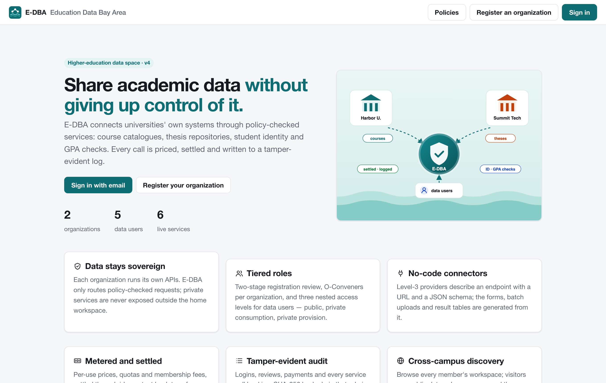

</div>

---

## 📖 About

Universities keep their data in silos: course catalogues, thesis repositories, student registries. Sharing it across institutions usually means either emailing spreadsheets or handing a partner direct database access. Neither keeps the owner in control. 🏝️

E-DBA is a small **data space** for higher education, inspired by the International Data Spaces (IDS) reference architecture. Each member organization keeps its own systems and exposes them through E-DBA as *services*. E-DBA decides who may call what, meters and settles every call, and writes it to a tamper-evident log.

- 🏛️ **Organizations** register through a two-stage review (E-Admin, then Senior E-Admin) and are run by an **O-Convener**, who verifies a bank account, uploads the member list (including whole email domains like `*@mail.uic.edu.cn`), pays membership fees and picks services.
- 👩‍🎓 **Data users** hold one of three nested access levels: **1** public data, **2** private data consumption (identity and GPA checks), **3** private data provision (manages courses and API connectors).
- 🔌 **Services**: course information, thesis sharing (display-only or download), student identity authentication and GPA records, the latter two also as spreadsheet batches. A level-3 provider wires each one to the organization's own API with a URL and a JSON schema; the pages are generated from that schema.
- 🌐 **Cross-campus**: anyone can browse any member's workspace, but as a visitor they are clamped to level 1 and only see public data, on the owner's terms and prices.
- 💳 **Settlement**: per-use prices and quotas, membership fees, idempotent bank transfers with a ledger. Downloading another organization's thesis pays *that* organization.
- 🔗 **Audit**: logins, reviews, payments and service calls go into a SHA-256 hash chain that admins can verify in one click.

This repository is **v4, a complete rebuild** of the 2025 course project. The original Flask/MySQL code depended on a lab server that is gone and had no tests. v4 keeps the product and every rule of the final requirement document, and replaces the implementation. What changed, and a requirement-by-requirement traceability table pointing at the tests, is in [`docs/v3-to-v4.md`](docs/v3-to-v4.md). 🔁

## 🧠 Architecture

<div align="center">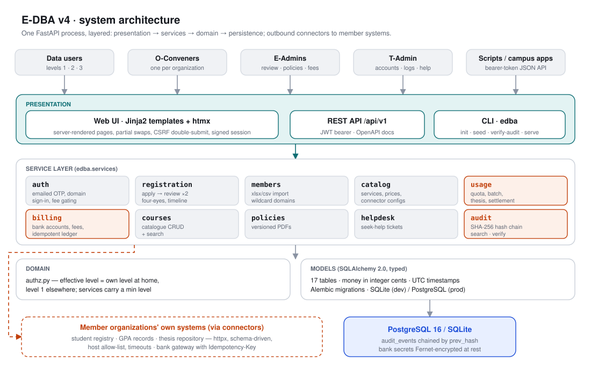</div>

| Layer | What it does | Code |
|---|---|---|
| **Presentation** | Server-rendered pages (Jinja2 + htmx, light/dark), JSON API with bearer tokens and OpenAPI docs, `edba` CLI | [`web/`](src/edba/web), [`api/v1.py`](src/edba/api/v1.py), [`cli.py`](src/edba/cli.py) |
| **Services** | Every business rule: sign-in, registration review, member import, catalog, usage + settlement, billing, policies, help desk, audit | [`services/`](src/edba/services) |
| **Authorization** | One place that answers "who may do what": effective level = own level at home, level 1 elsewhere | [`authz.py`](src/edba/authz.py) |
| **Models** | 17 tables, SQLAlchemy 2.0 typed mappings, money in integer cents, UTC timestamps, Alembic migrations | [`models/`](src/edba/models), [`migrations/`](migrations) |
| **Connectors** | Schema-driven outbound HTTP to members' systems and the bank, host allow-list, timeouts, idempotency keys | [`services/connector.py`](src/edba/services/connector.py) |
| **Demo gateway** | Stand-in for the campus registries, thesis repositories and bank the course used, with synthetic data | [`gateway/`](src/edba/gateway) |

### Registration

Every review appends a row; the applicant's status page is derived from those rows. (v3 inferred it from the final status and told applicants an *E-Admin* had rejected them when it was the Senior.)

<div align="center">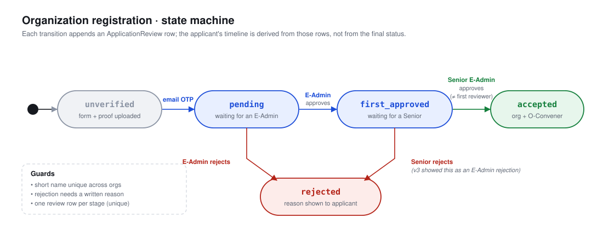</div>

### Who can do what

<div align="center">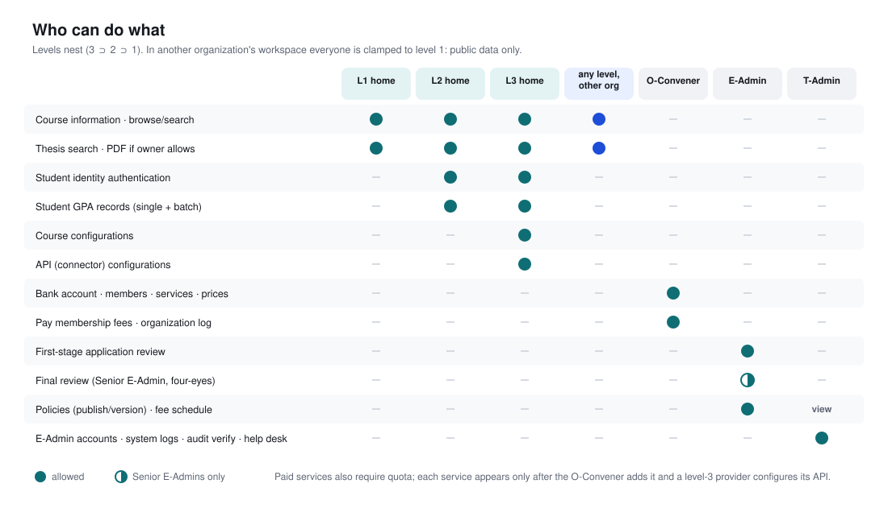</div>

### Paying for data across organizations

<div align="center">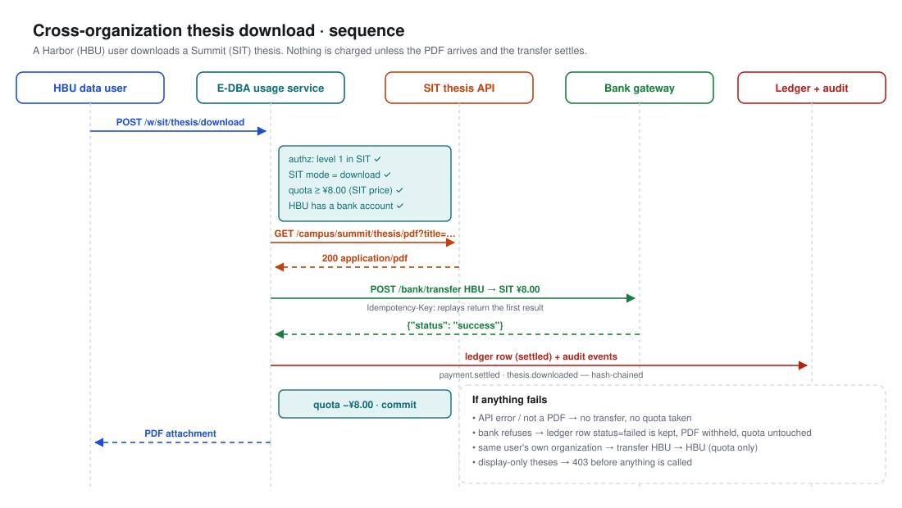</div>

### Data model

<div align="center">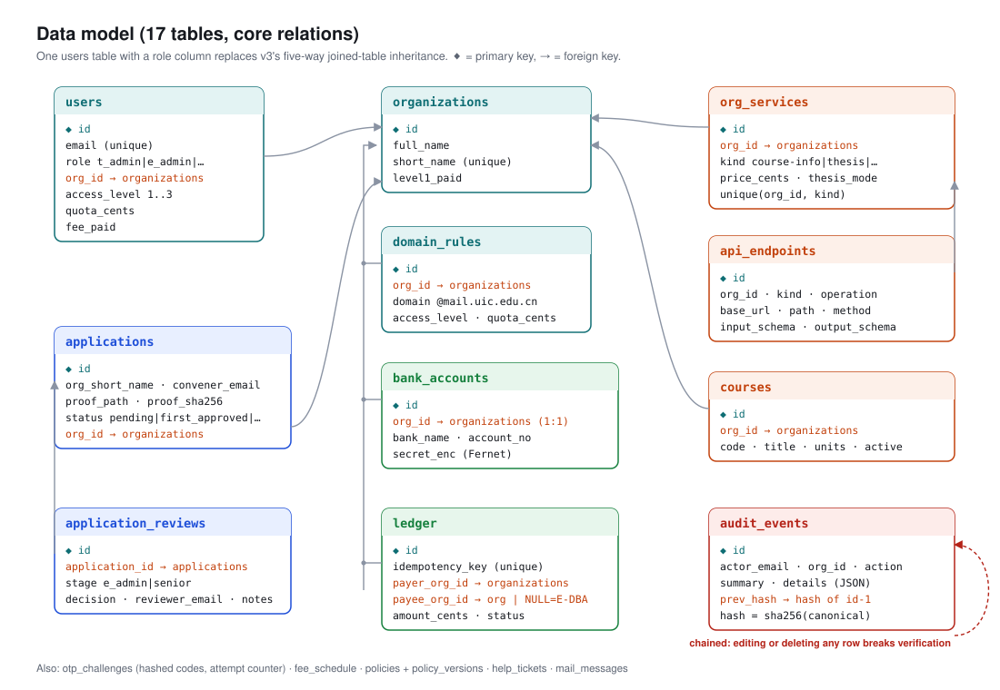</div>

## 🖼️ Tour

| | |
|:---:|:---:|
| 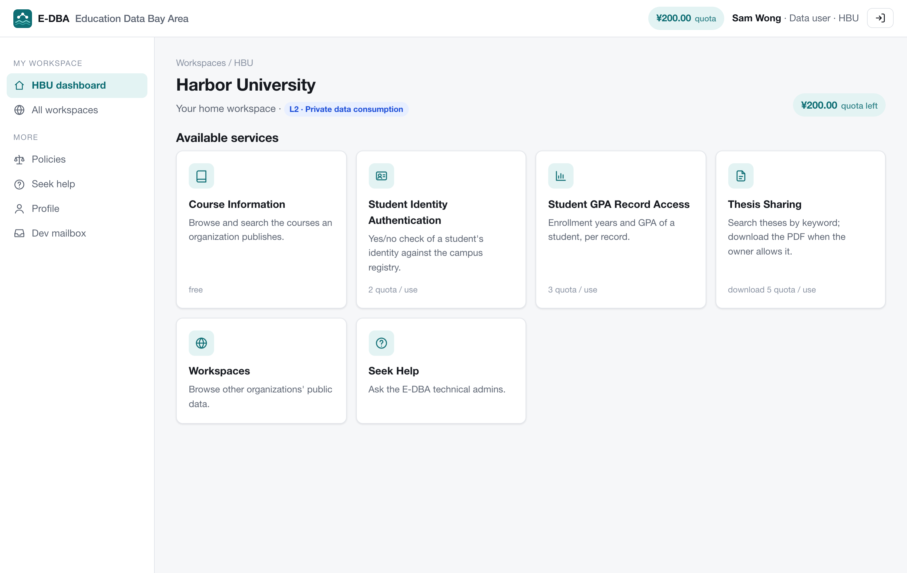<br>A level-2 data user's home workspace | 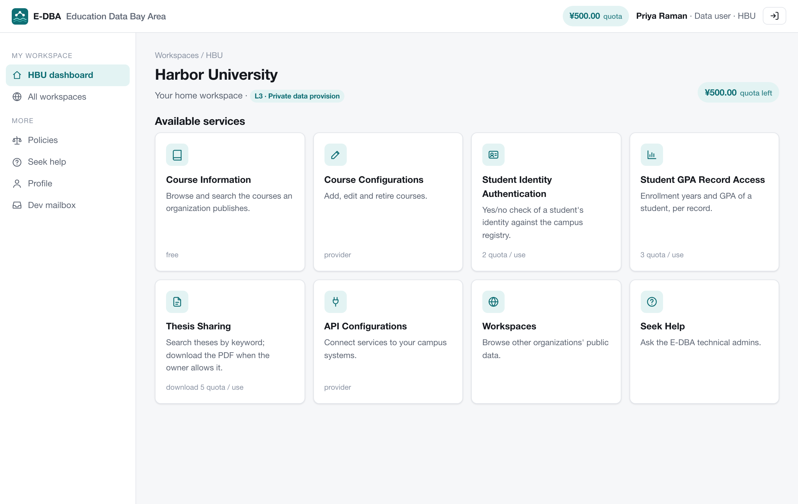<br>Level 3 adds course and API configuration |
| 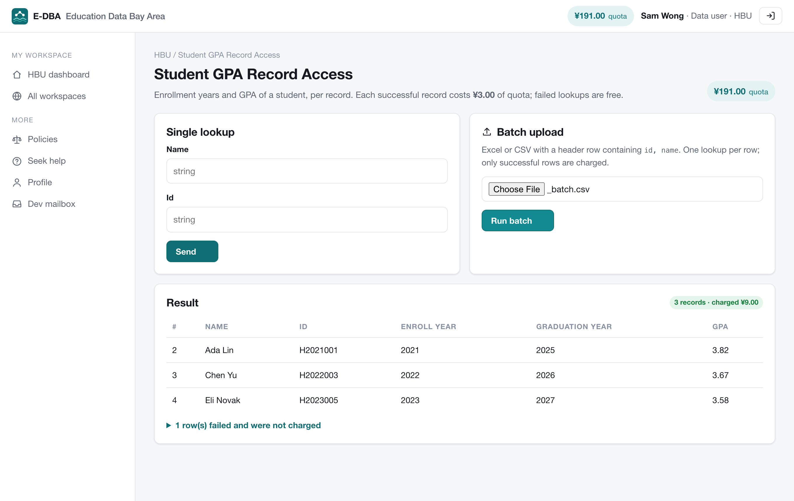<br>GPA batch upload: 4 rows, 3 found, 3 charged | 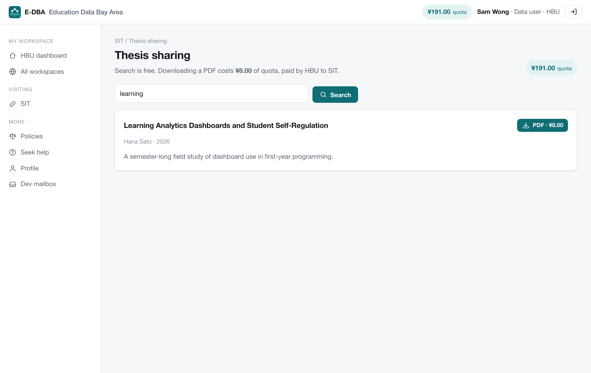<br>Visiting another organization's theses |
| 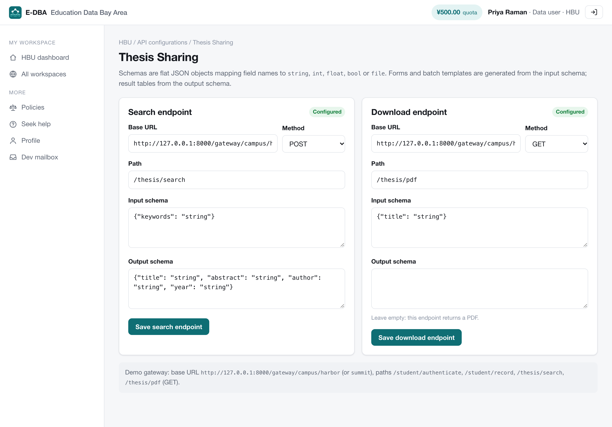<br>No-code connector for a thesis repository | 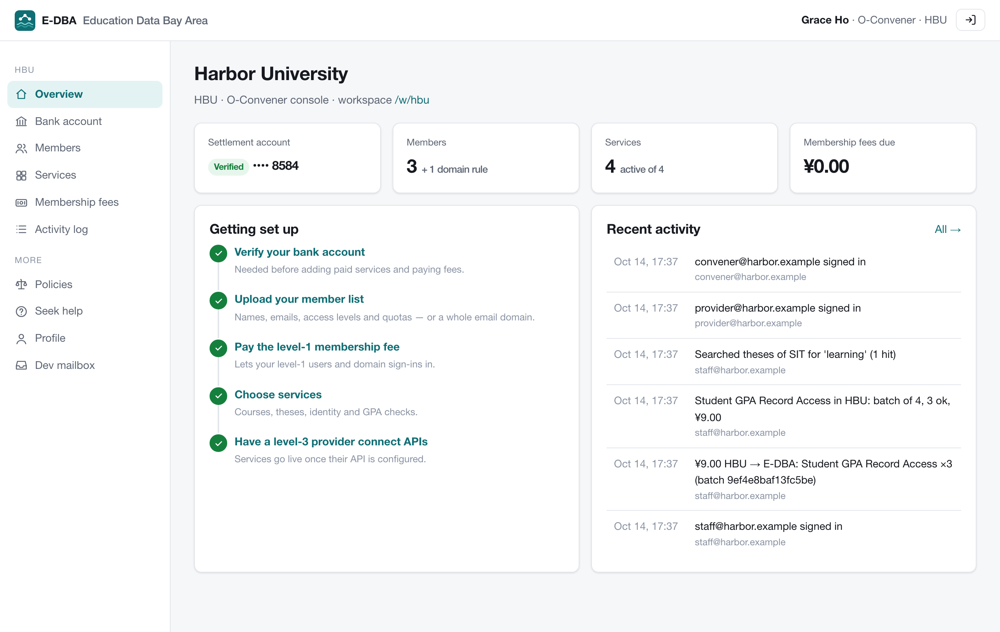<br>O-Convener console |
| 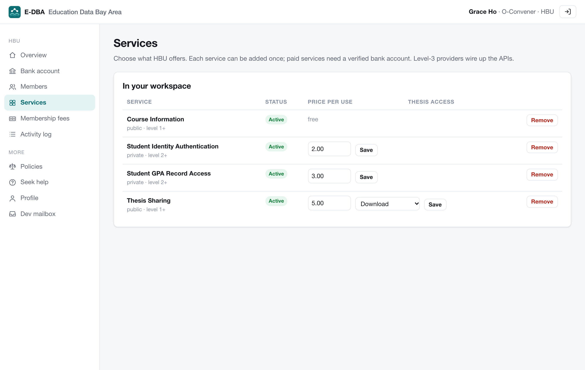<br>Services, prices and thesis access mode | 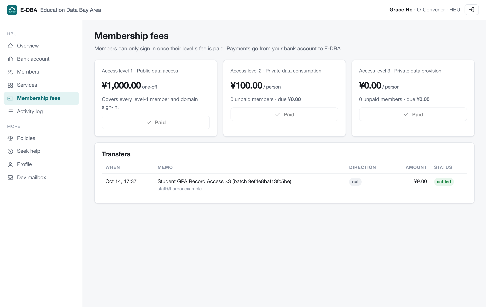<br>Membership fees and transfer history |
| 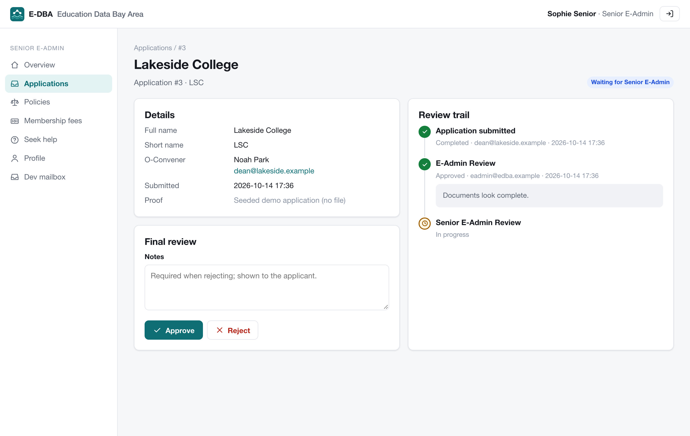<br>Final review by a Senior E-Admin | 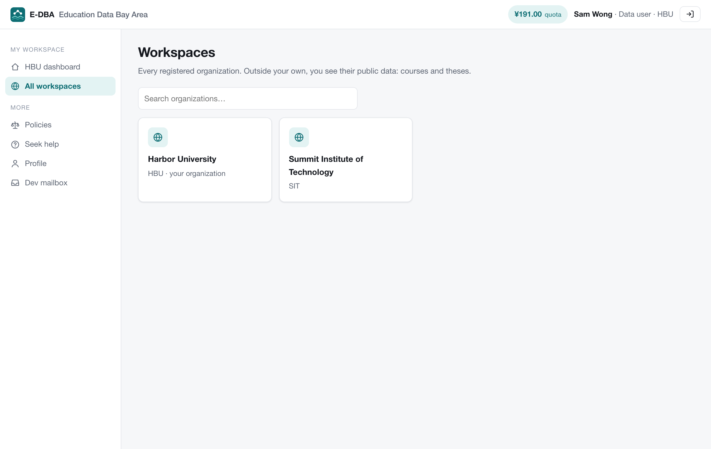<br>Workspace directory |
| 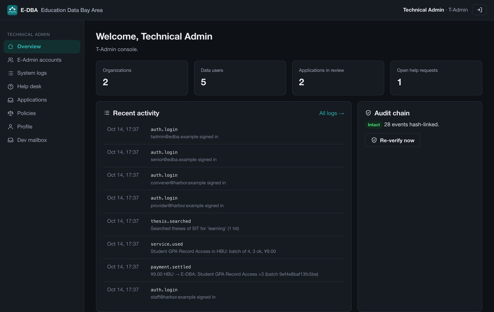<br>T-Admin overview with audit-chain status (dark) | 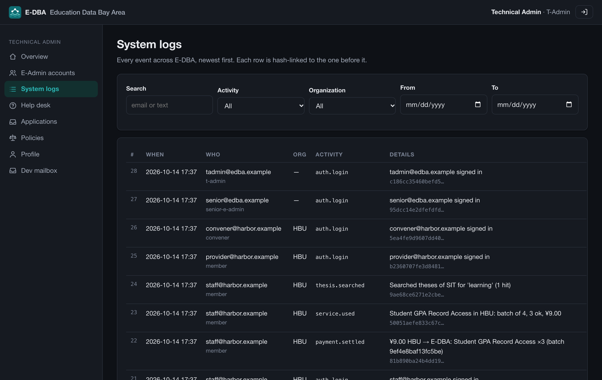<br>Hash-chained system logs (dark) |

## 🚀 Getting started

Requires Python 3.12+ and [uv](https://docs.astral.sh/uv/).

```bash
git clone https://github.com/Eric031212/E-DBA.git
cd E-DBA
uv sync
uv run edba init      # tables + bootstrap T-Admin
uv run edba seed      # two universities, members, services, applications
uv run edba serve     # http://127.0.0.1:8000
```

Sign-in is passwordless: enter an email, then the 6-digit code. In development, mail goes to the **dev mailbox** at <http://127.0.0.1:8000/dev/mailbox>. Demo accounts:

| Email | Role |
|---|---|
| `tadmin@edba.example` | T-Admin |
| `eadmin@edba.example` / `senior@edba.example` | E-Admin / Senior E-Admin |
| `convener@harbor.example` / `convener@summit.example` | O-Conveners of Harbor University (HBU) and Summit Institute of Technology (SIT) |
| `student@harbor.example` · `staff@harbor.example` · `provider@harbor.example` | HBU data users, levels 1 · 2 · 3 |
| `anything@students.harbor.example` | joins HBU at level 1 through a domain rule |
| `dean@lakeside.example` | applicant waiting for the final review |

The demo gateway is mounted at `/gateway` (OpenAPI at `/gateway/docs`, simulated bank balances at `/gateway/bank/balances`), so the whole system, including payments, runs offline.

### With Docker and PostgreSQL

```bash
docker compose up --build
docker compose exec web edba seed
```

### Configuration

Everything is an `EDBA_*` environment variable (see [`.env.example`](.env.example) and [`config.py`](src/edba/config.py)). For production set `EDBA_ENV=prod`, a long `EDBA_SECRET_KEY`, an `EDBA_DATA_KEY` for encrypting bank secrets, `EDBA_MAIL_BACKEND=smtp`, `EDBA_MOUNT_DEMO_GATEWAY=false`, a real `EDBA_BANK_GATEWAY_URL` and `EDBA_CONNECTOR_ALLOWED_HOSTS`, and run `alembic upgrade head` before starting.

## 🔌 API

Interactive docs at `/api/docs`.

```bash
curl -X POST localhost:8000/api/v1/auth/code  -H 'content-type: application/json' -d '{"email":"staff@harbor.example"}'
curl -X POST localhost:8000/api/v1/auth/token -H 'content-type: application/json' -d '{"email":"staff@harbor.example","code":"123456"}'
# → {"access_token": "...", "token_type": "bearer", "expires_in": 3600}

curl localhost:8000/api/v1/workspaces/hbu/services -H "Authorization: Bearer $TOKEN"
curl -X POST localhost:8000/api/v1/workspaces/hbu/services/gpa-record/query \
     -H "Authorization: Bearer $TOKEN" -H "Idempotency-Key: $(uuidgen)" \
     -H 'content-type: application/json' -d '{"values": {"name": "Ada Lin", "id": "H2021001"}}'
```

| Endpoint | |
|---|---|
| `POST /api/v1/auth/code`, `POST /api/v1/auth/token` | emailed code → JWT |
| `GET /api/v1/me` | profile, level, quota |
| `GET /api/v1/workspaces?q=` | organization directory |
| `GET /api/v1/workspaces/{slug}/services` | services the caller may use there |
| `GET /api/v1/workspaces/{slug}/courses?q=` | course search |
| `POST /api/v1/workspaces/{slug}/services/{kind}/query` | identity / GPA lookup (charged) |
| `POST /api/v1/workspaces/{slug}/thesis/search` · `/download` | theses (download charged, returns PDF) |
| `GET /api/v1/audit/verify` · `/audit/events` | hash-chain check and events (T-Admin; conveners see their own org) |

## ✅ Tests

```bash
uv run pytest                     # 69 tests, SQLite in memory
uv run pytest --cov=edba          # 93 % line coverage
EDBA_TEST_DATABASE_URL=postgresql+psycopg://user@host/edba_test uv run pytest   # same suite on PostgreSQL
uv run ruff check src tests && uv run mypy src
```

The suite drives the real web UI through the emailed-code sign-in (including CSRF tokens), the JSON API and the CLI, with the demo gateway and bank in the loop, and checks balances in the simulated bank after each payment. It covers every section of the v3 requirement document; the mapping is in [`docs/v3-to-v4.md`](docs/v3-to-v4.md#requirement-traceability). CI runs lint, type checks, the suite on Python 3.12 and 3.13, the suite and the migrations on PostgreSQL 16, and a Docker smoke test.

## 🗂️ Repository layout

```
src/edba/
  api/v1.py            JSON API
  authz.py             permission rules
  services/            business logic (auth, registration, members, catalog, usage, billing, audit, …)
  models/              SQLAlchemy models
  web/                 routes, Jinja2 templates, CSS, icons
  gateway/             demo campus + bank gateway
  seed.py, cli.py
migrations/            Alembic
tests/                 pytest suite
docs/figures/          architecture, state machine, data model, sequence, access matrix (SVG)
docs/screenshots/      UI screenshots
scripts/               render_diagrams.py, screenshots.py
```

Figures are generated by [`scripts/render_diagrams.py`](scripts/render_diagrams.py); screenshots by [`scripts/screenshots.py`](scripts/screenshots.py) against a seeded instance.

## 🙏 Acknowledgements

E-DBA started as the team project of the Software Engineering and Advanced Workshop courses in the Computer Science and Technology programme at Beijing Normal-Hong Kong Baptist University (BNBU), and was presented as the poster *Education Data Bay Area (E-DBA): A Secure and Compliant Data Sharing Platform for Higher Education*. Thanks to Dr. Judy Feng and Dr. Jefferson Fong for the requirements, the reviews and the lab infrastructure the original version ran against. The design draws on the [IDS Reference Architecture Model](https://internationaldataspaces.org/offers/reference-architecture/).

## 📄 License

[MIT](LICENSE)
